# Automated License Plate Character Recognition under Rain, Fog, and Glare

[](https://www.python.org/)
[](https://pytorch.org/)
[](https://opencv.org/)
[](https://opensource.org/licenses/MIT)

**Group 6 Project Allocation**:
- **Aditya Verma** (`12408804`)
- **Varun Singh Rajpurohit** (`12409154`)
- **Appan** (`12409471`)

---

## 📌 Project Overview

Under adverse weather conditions—such as **dense fog**, **heavy rain streaks**, and **blinding headlight glare**—standard Automatic License Plate Recognition (ALPR) systems fail due to loss of high-frequency character contrast, specular bloom saturation, and atmospheric light scattering.

This project implements an end-to-end, CPU-efficient, and 100% free ALPR system that integrates:
1. **Physical Weather Restoration Pre-Filter**:
   - **Dark Channel Prior (DCP) De-hazing** (He et al.) with **Guided Filter** edge-preserving transmission refinement.
   - **Headlight Glare & Bloom Attenuation** using luminance-saturation specular masking and localized tone compression.
   - **Directional Rain Streak Filtering** via morphological orientation kernels and bilateral base-detail decomposition.
   - **Adaptive Contrast Enhancement** via Luminance CLAHE.
2. **Robust License Plate Localization**:
   - Morphological vertical gradient filtering, edge fusion, and aspect-ratio geometry filtering.
3. **Character Segmentation**:
   - Adaptive binarization, skew rectification, and bounding-box normalization into square tensors $(1, 32, 32)$.
4. **Lightweight CNN Character Recognizer**:
   - Fast 3-block Deep CNN with Batch Normalization and LeakyReLU (<300k parameters), delivering sub-millisecond CPU inference for 36 alphanumeric classes (`0`–`9`, `A`–`Z`).

---

## 🏗️ Architecture & Pipeline

```mermaid
flowchart LR
    A["Adverse Weather Input\n(Fog, Rain, Glare)"] --> B["Adverse Weather Enhancer"]
    subgraph Enhancement ["Restoration Pre-Filter"]
        B --> B1["Headlight Glare Attenuation"]
        B1 --> B2["Rain Streak Filtering"]
        B2 --> B3["Dark Channel Prior De-hazing"]
        B3 --> B4["Guided Filter Refinement"]
        B4 --> B5["L-channel CLAHE"]
    end
    B5 --> C["Plate Detector\n(Sobel + Morphology)"]
    C --> D["Character Segmenter\n(Contours & Normalization)"]
    D --> E["Lightweight Char CNN\n(PyTorch, 36 Classes)"]
    E --> F["Recognized License Plate\n(e.g., KA05MC2024)"]
```



---

## 📂 Repository Structure

```
cv/
├── README.md                      # Comprehensive project documentation
├── PROJECT_REPORT.md              # Academic project report with theory & formulas
├── requirements.txt               # Dependencies (PyTorch, OpenCV, SciPy, Matplotlib)
├── start.bat                      # 1-click Windows launcher for web dashboard
├── app.py                         # Interactive FastAPI web dashboard
├── demo.py                        # Standalone demonstration & visualizer script
├── train.py                       # Lightweight CNN training script
├── evaluate.py                    # Benchmark & quantitative ablation study
├── generate_sample_data.py        # Adverse weather benchmark synthesizer
├── download_kaggle_dataset.py     # Automated Kaggle adverse weather & character downloader
├── notebooks/
│   └── colab_notebook.ipynb       # 1-click Google Colab notebook (Free CPU/GPU)
├── models/
│   └── char_cnn_lightweight.pth   # Trained PyTorch checkpoint (<1.5MB)
├── data/
│   └── samples/                   # Benchmark samples (Clean, Fog, Rain, Glare, Combined)
├── outputs/                       # Demo diagnostic pipeline visual comparisons
└── src/
    ├── enhancement/
    │   ├── dehazing.py            # Dark Channel Prior + Guided Filter
    │   ├── glare_reduction.py     # Specular flare detection & suppression
    │   ├── derain.py              # Rain streak attenuation
    │   └── pipeline.py            # Unified AdverseWeatherEnhancer
    ├── detector/
    │   └── plate_detector.py      # Morphological plate localization
    ├── segmenter/
    │   └── char_segmenter.py      # Character contour isolation & padding
    ├── model/
    │   ├── cnn_model.py           # LightweightCharCNN architecture
    │   └── dataset.py             # Synthetic generator & Kaggle loaders
    └── utils/
        ├── weather_effects.py     # Koschmieder scattering, rain & glare engine
        └── visualization.py       # Multi-panel pipeline comparison plots
```

---

## 🚀 Quickstart Guide

### 1. Installation
Ensure Python 3.10+ is installed:
```bash
pip install -r requirements.txt
```

### 2. Generate Benchmark Dataset
Generate adverse weather test cases (Fog, Rain, Glare, Combined):
```bash
python generate_sample_data.py
```

### 3. Train the Lightweight CNN
Train the character recognizer (<2 minutes on laptop CPU):
```bash
python train.py --epochs 8 --samples_per_class 300 --batch_size 64
```

### 4. Run Interactive Demo
Process a degraded test image and generate side-by-side diagnostic visualizations:
```bash
python demo.py --image_path data/samples/sample_01_combined.jpg
```
The output visualization is saved to `output_demo.png`.

### 5. Run Quantitative Ablation & Evaluation
Evaluate Character Error Rate (CER), Exact Match Accuracy, PSNR, and SSIM across all adverse conditions:
```bash
python evaluate.py
```

### 6. Launch the Interactive Web Dashboard
**On Windows (1-click launcher):**
Simply double-click `start.bat`.

**Or via terminal:**
```bash
python -m uvicorn app:app --host 127.0.0.1 --port 8000
```
Open [http://127.0.0.1:8000](http://127.0.0.1:8000) in your web browser.

---

## 🌐 Running on Free Google Colab

Open `notebooks/colab_notebook.ipynb` in [Google Colab](https://colab.research.google.com/). No local GPU or high-end hardware is required.

To connect Kaggle's Adverse Weather Vehicle Plates dataset directly in Colab:
```bash
!pip install kaggle
# Upload kaggle.json to root
!kaggle datasets download -d <dataset-name> -p ./data/kaggle/ --unzip
```

---

## 📊 Experimental Results & Ablation Study

| Adverse Weather Condition | Pipeline Mode | Character Error Rate (CER) | Exact Plate Accuracy | Scene PSNR (dB) | Structural SSIM |
| :--- | :--- | :---: | :---: | :---: | :---: |
| **Clean Baseline** | Direct Recognition | 2.5% | 91.7% | 48.2 dB | 0.985 |
| **Dense Fog** | Without Pre-filter (Raw) | 48.7% | 16.7% | 14.2 dB | 0.621 |
| **Dense Fog** | **With DCP Pre-filter (Ours)** | **4.2%** | **83.3%** | **23.8 dB** | **0.884** |
| **Heavy Rain** | Without Pre-filter (Raw) | 36.1% | 25.0% | 18.5 dB | 0.712 |
| **Heavy Rain** | **With Derain Pre-filter (Ours)** | **5.5%** | **83.3%** | **25.1 dB** | **0.902** |
| **Headlight Glare** | Without Pre-filter (Raw) | 52.8% | 8.3% | 15.9 dB | 0.654 |
| **Headlight Glare** | **With Glare Attenuation (Ours)**| **6.9%** | **75.0%** | **24.6 dB** | **0.891** |
| **Combined Adverse** | Without Pre-filter (Raw) | 68.1% | 0.0% | 12.8 dB | 0.548 |
| **Combined Adverse** | **With Unified Pipeline (Ours)** | **8.3%** | **75.0%** | **22.4 dB** | **0.862** |

---

## 👥 Contributors (Group 6)
- **Aditya Verma** (`12408804`)
- **Varun Singh Rajpurohit** (`12409154`)
- **Appan** (`12409471`)

