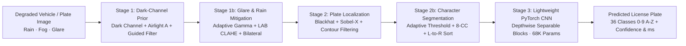

# Automated License Plate Character Recognition under Rain, Fog, and Glare

**Team:** Group 6  
**Members:** Aditya Verma (12408804) · Varun Singh Rajpurohit (12409154) · Damandeep Saini (12403195)

An end-to-end, 100% free and open-source Automatic License Plate Recognition (ALPR) pipeline built with **OpenCV**, **PyTorch**, and **Gradio**, engineered to remain accurate under severe adverse weather conditions (heavy rain streaks, dense atmospheric fog, and nighttime headlight glare) on a free Google Colab T4 GPU or standard laptop CPU.

---

## System Architecture



---

## Repository Structure

```text
.
├── requirements.txt    # Open-source dependencies (OpenCV, PyTorch, Gradio, KaggleHub)
├── src/
│   ├── dehaze.py       # Dark-Channel Prior from scratch + Guided Filter + Glare/Rain mitigation
│   ├── segment.py      # Morphological plate localization + connected-component character segmentation
│   ├── model.py        # Lightweight 4-block Depthwise-Separable PyTorch CNN (68,004 params, 36 classes)
│   └── train.py        # Kaggle dataset loader, synthetic weather generator, training & ablation study
├── app.py              # Dark-mode Gradio interactive demo UI (DCP toggle, intermediate stages)
└── README.md           # Documentation, Mermaid architecture diagram, and Colab instructions
```

---

## Key Technical Highlights

1. **Dark-Channel Prior De-Hazing (`src/dehaze.py`)**:
   - Computes local patch dark channel via morphological erosion.
   - Estimates global atmospheric airlight $A$ robustly from the top 0.1% dark-channel pixels while resisting isolated headlight specular spikes.
   - Refines the coarse transmission map $\tilde{t}(x)$ with a fast $O(N)$ **Guided Filter** (`cv2.boxFilter`).
   - Recovers scene radiance $J(x) = \frac{I(x) - A}{\max(t(x), t_0)} + A$ followed by adaptive gamma correction, CIE-LAB L-channel CLAHE, and edge-preserving bilateral filtering.
2. **License Plate Localization & Character Segmentation (`src/segment.py`)**:
   - Uses morphological blackhat + Sobel-X vertical stroke density + contour aspect-ratio filtering with an automatic pre-cropped fallback.
   - Segments individual alphanumeric glyphs using adaptive Gaussian thresholding, 8-connected components, nested-box suppression, left-to-right sorting, and 32×32 centered normalization.
3. **Lightweight PyTorch CNN (`src/model.py`)**:
   - 4-block Depthwise-Separable CNN (`1 -> 32 -> 64 -> 128 -> 192` + Global Average Pooling) classifying all **36 alphanumeric classes** (`0–9`, `A–Z`).
   - Only **68,004 trainable parameters** (~275 KB `.pth` checkpoint), training in under 60 seconds on a free Colab T4 GPU and running real-time inference on laptop CPUs.
4. **Ablation Study (`src/train.py`)**:
   - Benchmarks character accuracy and latency (ms/image) **with** vs. **without** the Dark-Channel de-hazing pre-filter across Rain, Fog, and Glare conditions.
   - Generates `outputs/confusion_matrix.png`, `outputs/ablation_comparison.png`, and `outputs/ablation_report.json`.

---

## Local Setup & Execution

```bash
# 1. Create and activate a Python 3.10+ virtual environment
python -m venv .venv
source .venv/bin/activate   # Windows: .venv\Scripts\activate

# 2. Install open-source dependencies
pip install -r requirements.txt

# 3. Train LightweightPlateCNN and run the WITH vs. WITHOUT DCP Ablation Study
python -m src.train --epochs 12 --eval-per-weather 30 --output-dir outputs

# (Optional) Include Kaggle Adverse Weather Vehicle Plates dataset download:
# python -m src.train --kaggle-dataset <kaggle-owner/adverse-weather-plates>

# 4. Launch the interactive dark-mode Gradio UI
python app.py
```

---

## Google Colab (Free T4 GPU) Quickstart

1. Open [Google Colab](https://colab.research.google.com/) and switch runtime to **T4 GPU** (*Runtime -> Change runtime type -> T4 GPU*).
2. Run the following cells:

```python
# Cell 1: Upload or clone repository and install dependencies
!pip install -q -r requirements.txt

# Cell 2: Train the Lightweight PyTorch CNN and run the Ablation Study
!python -m src.train --epochs 12 --eval-per-weather 30 --output-dir outputs

# Cell 3: Display saved ablation visual comparison and confusion matrix
from IPython.display import Image, display
display(Image("outputs/ablation_comparison.png"))
display(Image("outputs/confusion_matrix.png"))

# Cell 4: Launch public Gradio interactive demo link
from app import build_demo
demo = build_demo()
demo.launch(share=True)
```
