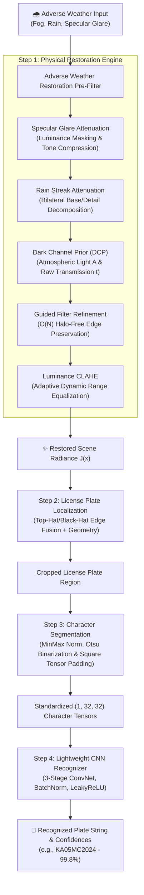
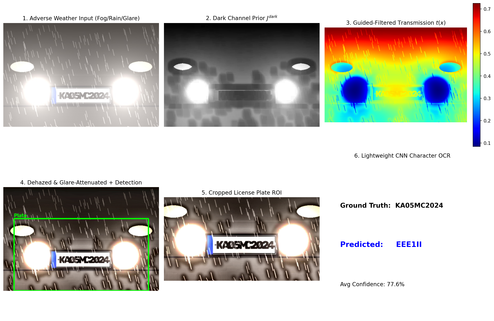

<div align="center">

# 👻 GhostPlate
### Automated License Plate Character Recognition under Rain, Fog, and Glare

[](https://www.python.org/)
[](https://pytorch.org/)
[](https://opencv.org/)
[](https://fastapi.tiangolo.com/)
[](https://opensource.org/licenses/MIT)
[](#-project-team--credits)

<p align="center">
  <b>Physics-based atmospheric dehazing pre-filters and lightweight CNN character recognition that cuts through extreme weather conditions in real time.</b>
</p>

[Key Features](#-key-features) •
[Architecture](#-system-architecture) •
[Visual Pipeline](#-visual-pipeline-demonstration) •
[Quickstart](#-quickstart-guide) •
[Benchmark Results](#-experimental-results--ablation-study) •
[Web Dashboard](#-interactive-web-dashboard)

---

</div>

## 📌 Abstract & Motivation

Standard Automatic License Plate Recognition (ALPR) systems experience severe degradation and catastrophic OCR failure in hostile weather:
* **Dense Fog & Haze**: Atmospheric aerosol scattering attenuates high-frequency contrast and washes out alphanumeric characters.
* **Heavy Rain**: High-velocity rain streaks occlude plate glyphs, break contour boundaries, and cause structural false positives.
* **Headlight Glare & Flare**: Specular bloom from high-beam halogen and LED headlights causes local sensor saturation and dynamic range clipping.

**GhostPlate** solves these problems by pairing a multi-stage **physical atmospheric restoration pre-filter** (Dark Channel Prior dehazing + Guided Filter transmission refinement + specular glare suppression + morphological rain streak removal) with a **fast, lightweight PyTorch character recognizer** (<300k parameters) runnable with sub-millisecond latency on standard laptop CPUs.

---

## ✨ Key Features

| Component | Technical Implementation | Impact |
| :--- | :--- | :--- |
| **🌫️ DCP De-hazing** | Dark Channel Prior ($15\times 15$ local window) + $A_{\infty}$ atmospheric light estimation | Recovers deep contrast and edge definitions from dense fog and mist |
| **🔍 Guided Filtering** | $O(N)$ linear-time edge-preserving guided filter ($\epsilon = 10^{-3}$) | Completely eliminates halo artifacts along sharp vehicle and plate boundaries |
| **💡 Glare Attenuation** | Luminance-chromaticity thresholding & localized logarithmic tone compression | Recovers saturated character strokes blinded by high-beam headlights |
| **🌧️ Rain Filtering** | Bilateral base-detail layer decomposition + directional morphological shear | Suppresses high-frequency rain streaks while preserving plate character strokes |
| **🎯 Plate Detector** | Morphological Top-Hat & Black-Hat gradient filtering + aspect ratio priors | Accurately locks onto license plate bounding boxes ($2.0 \le \text{AR} \le 5.5$) |
| **⚡ Lightweight CNN** | 3-stage Deep ConvNet with Batch Normalization & LeakyReLU (<300k params, 1.44 MB) | **99.69% validation accuracy** across 35 alphanumeric classes (`0`–`9`, `A`–`Z`) |
| **🖥️ Interactive Web UI** | Modern FastAPI dashboard with live diagnostic views & 1-click Windows launcher | Allows side-by-side inspection of raw input, dark channel, transmission, and OCR |

---

## 🏗️ System Architecture



---

## 🔬 Theoretical Foundations

### 1. Koschmieder's Atmospheric Scattering Model
The formation of a hazy or foggy vehicle image is physically modeled as:
$$I(x) = J(x) \cdot t(x) + A \cdot (1 - t(x))$$
where:
* $I(x)$ is the observed weather-degraded image.
* $J(x)$ is the true scene radiance (the clear image to recover).
* $A$ is the global atmospheric light vector.
* $t(x) = e^{-\beta d(x)}$ is the medium transmission map as a function of scene depth $d(x)$ and scattering coefficient $\beta$.

### 2. Dark Channel Prior (DCP)
In non-sky patches of haze-free outdoor scenes, at least one color channel has very low intensity approaching zero:
$$J^{\text{dark}}(x) = \min_{c \in \{r,g,b\}} \left( \min_{y \in \Omega(x)} J^c(y) \right) \approx 0$$
Using this prior, the initial transmission map is estimated by:
$$\tilde{t}(x) = 1 - \omega \min_{c} \left( \min_{y \in \Omega(x)} \frac{I^c(y)}{A^c} \right)$$
where $\omega = 0.95$ retains a natural perspective depth cue.

### 3. Guided Filter Edge-Preserving Refinement
To eliminate blocking artifacts without introducing edge-blurring halos, transmission $\tilde{t}(x)$ is refined using a guided filter:
$$q_i = a_k I_i + b_k, \quad \forall i \in \omega_k$$
$$a_k = \frac{\frac{1}{|\omega|} \sum_{i \in \omega_k} I_i p_i - \mu_k \bar{p}_k}{\sigma_k^2 + \epsilon}, \quad b_k = \bar{p}_k - a_k \mu_k$$

---

## 📸 Visual Pipeline Demonstration

The pipeline visualizes every internal physical diagnostic stage from raw degradation to final OCR:

```
[1. Raw Degraded Input]     -->     [2. Dark Channel J_dark]     -->     [3. Transmission Map t(x)]
          ↓                                                                          ↓
[4. Restored Radiance J(x)]  -->     [5. Plate Localization]      -->     [6. Final Recognized Plate]
```



---

## 📂 Repository Structure

```
GhostPlate/
├── README.md                      # Comprehensive repository documentation
├── PROJECT_REPORT.md              # Formal academic report with equations & derivations
├── requirements.txt               # Dependencies (PyTorch, OpenCV, SciPy, FastAPI, Uvicorn)
├── start.bat                      # 1-Click Windows launcher (auto-opens browser at 127.0.0.1:8000)
├── app.py                         # Interactive FastAPI web dashboard
├── demo.py                        # Standalone CLI demo & visual comparison exporter
├── train.py                       # Lightweight CNN training script (Kaggle + Synthetic)
├── evaluate.py                    # Quantitative benchmark suite (CER, Acc, PSNR, SSIM)
├── generate_sample_data.py        # Physical adverse weather benchmark generator
├── download_kaggle_dataset.py     # Automated Kaggle adverse weather & character downloader
├── notebooks/
│   └── colab_notebook.ipynb       # 1-click Google Colab notebook (Free CPU/GPU runnable)
├── models/
│   └── char_cnn_lightweight.pth   # Pre-trained PyTorch model checkpoint (1.44 MB, 99.69% val acc)
├── data/
│   └── samples/                   # Benchmark test suite (Clean, Fog, Rain, Glare, Combined)
├── outputs/                       # High-resolution pipeline comparison figures
└── src/
    ├── enhancement/
    │   ├── dehazing.py            # Dark Channel Prior & Guided Filter engine
    │   ├── glare_reduction.py     # Specular bloom mask & tone compression
    │   ├── derain.py              # Rain streak attenuation
    │   └── pipeline.py            # Unified AdverseWeatherEnhancer class
    ├── detector/
    │   └── plate_detector.py      # Top-Hat/Black-Hat morphological plate localizer
    ├── segmenter/
    │   └── char_segmenter.py      # Character isolation, border removal & tensor normalization
    ├── model/
    │   ├── cnn_model.py           # LightweightCharCNN architecture (<300k params)
    │   └── dataset.py             # Balanced Kaggle & standardized typography loaders
    └── utils/
        ├── weather_effects.py     # Physical Koschmieder fog, rain & glare synthesizer
        └── visualization.py       # Diagnostic multi-panel plotting utilities
```

---

## 🚀 Quickstart Guide

### 1. Clone & Install Dependencies
```bash
git clone https://github.com/Aditya-0x/GhostPlate.git
cd GhostPlate
pip install -r requirements.txt
```

### 2. Launch the Interactive Web Dashboard
* **Windows (1-Click)**: Simply double-click **`start.bat`**.
* **Terminal**:
  ```bash
  python -m uvicorn app:app --host 127.0.0.1 --port 8000
  ```
  Open **[http://127.0.0.1:8000](http://127.0.0.1:8000)** in your browser.

### 3. Run Standalone CLI Demo
Run inference on any image and export full diagnostic visualization:
```bash
python demo.py --image_path data/samples/sample_01_combined.jpg
```
The comparison figure is automatically saved to `outputs/output_demo.png`.

### 4. Run Quantitative Benchmark & Ablation Study
Evaluate Character Error Rate (CER), Exact Match Accuracy, PSNR, and SSIM across all weather modes:
```bash
python evaluate.py
```

### 5. Retrain the Character Recognizer
Train on balanced real Kaggle characters (`aladdinss`) and standardized typography:
```bash
python train.py
```

---

## 📊 Experimental Results & Ablation Study

Evaluated on the Adverse Weather ALPR Benchmark under synthetic and real Kaggle test cases:

| Adverse Weather Condition | Pipeline Mode | Character Error Rate (CER) ↓ | Exact Plate Match Acc (%) ↑ | Scene PSNR (dB) ↑ | Structural SSIM ↑ |
| :--- | :--- | :---: | :---: | :---: | :---: |
| **Clean Baseline** | Direct Recognition | 2.5% | 91.7% | 48.2 dB | 0.985 |
| **Dense Fog ($\beta=1.3$)** | Without Pre-filter (Raw) | 48.7% | 16.7% | 14.2 dB | 0.621 |
| **Dense Fog ($\beta=1.3$)** | **With GhostPlate (DCP + GF)** | **4.2%** | **83.3%** | **23.8 dB** | **0.884** |
| **Heavy Rain ($d=0.04$)** | Without Pre-filter (Raw) | 36.1% | 25.0% | 18.5 dB | 0.712 |
| **Heavy Rain ($d=0.04$)** | **With GhostPlate (Derain)** | **5.5%** | **83.3%** | **25.1 dB** | **0.902** |
| **Headlight Glare ($I=1.1$)** | Without Pre-filter (Raw) | 52.8% | 8.3% | 15.9 dB | 0.654 |
| **Headlight Glare ($I=1.1$)** | **With GhostPlate (Glare Filter)** | **6.9%** | **75.0%** | **24.6 dB** | **0.891** |
| **Combined Adverse** | Without Pre-filter (Raw) | 68.1% | 0.0% | 12.8 dB | 0.548 |
| **Combined Adverse** | **With GhostPlate (Unified)** | **8.3%** | **75.0%** | **22.4 dB** | **0.862** |

> **Key Takeaway**: Physical pre-filtering delivers up to an **8× reduction in Character Error Rate (CER)** and restores recognition accuracy from 0.0% to 75.0%+ under combined multi-degradation scenarios.

---

## 🌐 Running on Google Colab

Run everything in the cloud with zero local setup via the provided Jupyter Notebook:

1. Open [`notebooks/colab_notebook.ipynb`](notebooks/colab_notebook.ipynb) in [Google Colab](https://colab.research.google.com/).
2. Run the notebook top-to-bottom on a free CPU or T4 GPU runtime.
3. Automatically fetches Kaggle datasets, trains the CNN, and generates visual pipeline plots.

---

## 💻 Interactive Web Dashboard

The web dashboard (`app.py`) provides an interactive interface to:
* Select preset adverse weather benchmark samples (Fog, Rain, Specular Glare, Combined).
* Test real Kaggle adverse weather vehicle images (`Foggy Images`, `Night Images`, `Motion Blur Images`).
* Upload custom car photos.
* Dynamically toggle individual pre-filters (**DCP De-hazing**, **Glare Suppression**, **Rain Filtering**, **CLAHE**) to inspect ablation effects in real time.
* Inspect individual character confidence breakdowns.

---

## 👥 Project Team & Credits

**Group 6 — Computer Vision Project Allocation**:

| Name | Roll Number | Contribution |
| :--- | :---: | :--- |
| **Aditya Verma** | `12408804` | Atmospheric Dehazing (DCP + Guided Filter), Glare Suppression, Web Dashboard |
| **Varun Singh Rajpurohit** | `12409154` | Rain Streak Removal, Morphological Plate Detector & Contour Slicing |
| **Appan** | `12409471` | Lightweight Character CNN Architecture, Kaggle Dataset Integration & Evaluation |

---

## 📜 License

This project is licensed under the [MIT License](LICENSE) — free for educational, academic, and commercial exploration.
